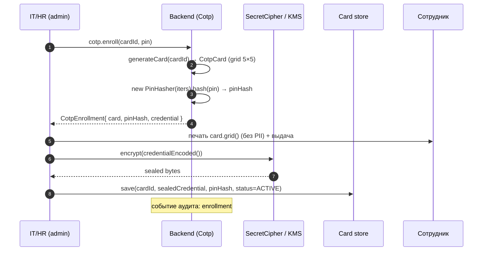
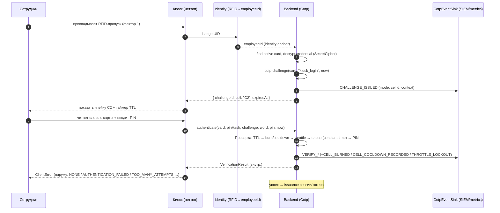
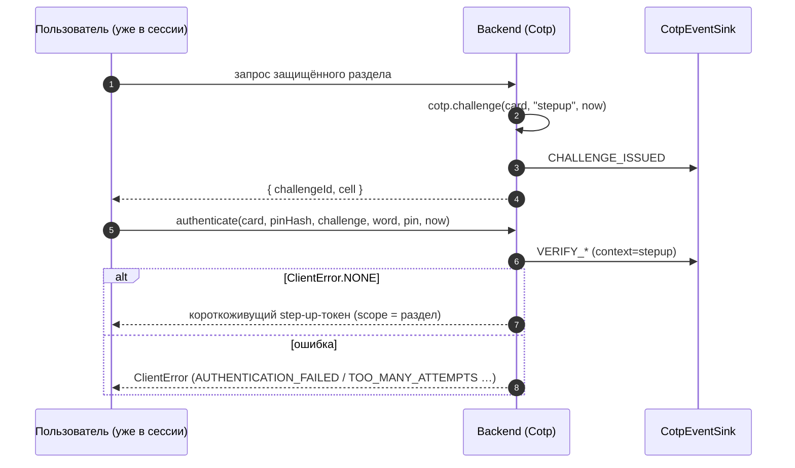
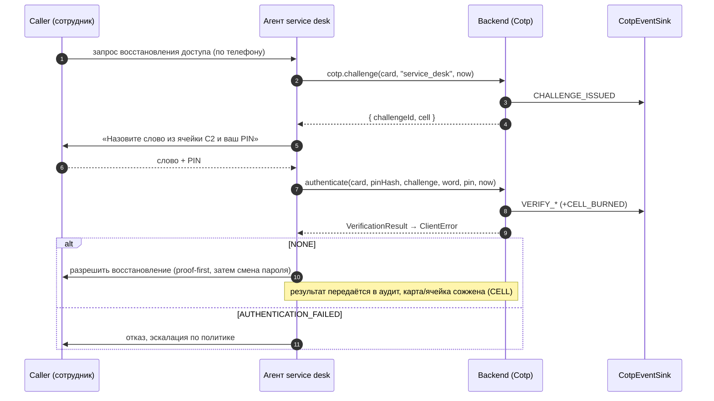
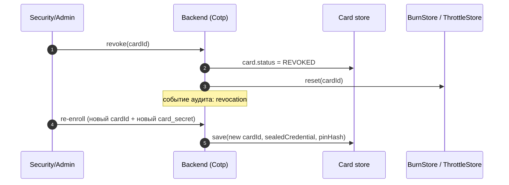

# COTP — диаграммы последовательностей

Дополняет `COTP_SPECIFICATION.md` (§16) и `docs/OPERATIONS_RUNBOOK.md`. Схемы отражают реальный
API библиотеки: `Cotp`, `CotpEnrollment`, `CotpCredential`, `CotpPolicyResolver`,
`VerificationResult`, `ClientError`, `CotpEventSink`.

Общие принципы:
- Сервер (backend) — единственная доверенная зона; печатная карта и публичная стойка — недоверенные.
- Все обмены «клиент ↔ сервер» — по TLS.
- Детальный `VerificationResult` остаётся внутри; наружу отдаётся `ClientError` (anti-oracle, §11.7).
- Каждая выдача челленджа/проверка эмитит событие в `CotpEventSink` (аудит/метрики, §16.8).

## 1. Enrollment (выпуск карты)

## 2. Вход на публичной стойке (RFID + COTP)

## 3. Step-up для защищённого раздела (независимо от способа входа)

## 4. Service desk — верификация личности

## 5. Ревокация / перевыпуск карты

## Примечания

- `"kiosk_login"` / `"stepup"` / `"service_desk"` — контексты `CotpPolicyResolver` (спека §16.9):
  `kiosk_login → COOLDOWN 24 ч`, `stepup → CHALLENGE 60 с`, `service_desk → CELL`.
- Burn/cooldown/throttle-семантика — `docs/OPERATIONS_RUNBOOK.md`, спека §11.3–11.4.
- Модель угроз и остаточные риски (в т.ч. реконструкция сетки при наблюдении) — `docs/THREAT_MODEL.md`.
